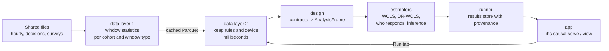

# ihs-causal: design and methods

What the package estimates, from which data, and how. It covers methods only. Results live in each machine's `work/`
folder and are never part of the repository.

## Questions

| # | Question | Contrast |
|---|---|---|
| Q1 | Do the messages have any effect? | `any_vs_none` |
| Q2 | Does the therapeutic strategy matter? | `strategy_vs_none` (within the outcome's domain), `strategy_pairwise` |
| Q2T | Which message type works: strategy with or without own data? | `type_vs_none` (the nine types in the outcome's domain against no message), `type_any_vs_none` |
| Q3 | Does showing people their own data matter? | `data_vs_nodata`, `data_within_strategy` |
| Q4 | Do messages move their own domain? | `domain_vs_none`, where the message domain matches the outcome |
| Q5 | Are there cross-domain effects? | `domain_vs_none`, where it does not |
| Q6 | Who responds: do effects vary with baseline traits, and between people? | estimator `drwcls_hetero` |

The 2024 and 2025 cohorts are analysed separately and never pooled. In 2025 the message domain is randomized by week,
so a domain contrast compares messages with no-message days within that domain's weeks.

## Architecture

| Layer | Module | What it does | Registry |
|---|---|---|---|
| data | `data/hourly.py` | Reads an hourly file once into a compact table, one row per participant and UTC hour | — |
| data | `data/decisions.py` | One decision table per cohort in a common schema: anchor hour, analysis flag, send, domain, strategy, own-data display, arm, and every randomization probability made unconditional | cohort adapters |
| data | `data/windows.py` | Window definitions and prefix-sum aggregation: any window's sum, count, mean or SD is two array lookups | `WINDOWS` |
| data | `data/features.py` | Layer 1 `window_stats`: per decision, window and instrument, steps, observed hours, overnight observed hours, heart rate, resting heart rate, sleep minutes and mood. Layer 2 `apply_rules`: outcomes and covariates for one device under one set of keep rules | outcomes |
| design | `design/contrasts.py` | Picks rows, arms and probabilities for a contrast and returns `AnalysisFrame`s | `CONTRASTS` |
| estimators | `estimators/` | Weighted least squares with clustered sandwich; WCLS; DR-WCLS; who responds; cross-fitted learners; multiplier bootstrap | `ESTIMATORS`, `LEARNERS` |
| runner | `runner.py`, `results.py` | Expands a configuration and stores every estimate with its settings, input hashes, timings and diagnostics | — |
| app | `serve.py`, `viewer/` | Local results app with a Run tab, or a static snapshot | — |
| setup | `paths.py`, `check.py`, `cli.py` | Where the data are, whether they have what the engine reads, and the commands | — |

The contract between the design and estimator layers is the `AnalysisFrame`: outcome, arm codes (0 = reference), the
randomization probability of every analysed arm, participant, covariates. Estimators never see the decision table, so
they work the same for both cohorts and every contrast.

## Data files

| Cohort | Kind | Standard name in `data_root` |
|---|---|---|
| 2024 | hourly | `dfHourly2024.csv` |
| 2024 | decisions | `2024BehaviorAgentProbabilities.csv` |
| 2024 | surveys | `2024SurveyData.csv` |
| 2024 | message types (optional) | `2024MessageTypeProbabilities.csv.gz`, needed only for the 2024 message-type questions |
| 2025 | hourly | `dfHourly2025.csv` |
| 2025 | decisions | `2025BehaviorAgentProbabilities.csv` |
| 2025 | timing | `2025DecisionTiming.csv` (window anchor and analysis flag) |
| 2025 | surveys | `2025SurveyData.csv` |

`ihs-causal check` lists the columns each file must have (`check.py`, `NEEDS`) and reads headers only.
`config/paths.yaml` can point any file elsewhere under `files:`; a relative path there is inside `data_root`.

**Data versions.** Every stored analysis records the SHA-256 of each input file. Run IDs describe settings only, so an
analysis keeps its ID across data versions. From the command line a stored run is skipped only when it was made from
the current files; the app flags analyses made from earlier files, with a button that reruns them (`ihs-causal
refresh` does the same). A run that had nothing to estimate is remembered with the files it was tried on, so a full
rerun does not retry it until the files change. When a builder's output changes, bump its number in
`workspace.VERSIONS` so cached tables are rebuilt.

## Windows, keep rules and devices

All defaults are in `src/ihs_causal/defaults.yaml`; every number is a setting in configurations and in the Run tab.

**Window.** From the decision's anchor (the logged send, or the time a message would have gone out) to the next day's
decision. Decisions are laid on a daily grid, so a skipped day gives a 24-hour window. A window must be a day long:
20 to 28 hours. History covariates come from the previous day's window. 2025 anchors at `window_anchor_utc` from the
timing file; 2024 at the decision hour.

**Analysis set.** 2024: decisions from July 1, 2024 to June 30, 2025 with a recorded time. 2025: decisions with the
main analysis flag (`retain_main_reach_retrospective`). `date_from` and `date_to` narrow the range.

**Keep rules.**

| Outcome | A day is kept when | Outcome value |
|---|---|---|
| Steps | the device was observed in at least `steps_min_observed_hours` = 10 hours. An hour is observed when it has heart rate or a positive step count; a blank step cell in an observed hour is a real zero. | log(1 + steps) |
| Sleep | a sleep record exists in the window (the unit is the night). A night under `sleep_short_night_minutes` = 180 is kept only if the device was observed for at least `sleep_night_wear_min` = 67% of the overnight hours (22:00 to 07:00 local). No record means missing, not zero. | minutes asleep |
| Mood | the window holds a response | mean response |

A zero step cell is not evidence of wear (Garmin writes zeros in every hour). People with only an iPhone have no
heart-rate signal, so for them observed means "has steps".

**Devices.**

| Device | Who and what |
|---|---|
| Combined | Each person contributes their main instrument: Fitbit, Garmin or Apple, whichever has the most observed hours in their post windows. Mood is kept for everyone, including people without a wearable. |
| Apple | Watch hour, else iPhone hour (`apple_source: watch_then_phone`), or the watch alone (`watch_only`). |
| Garmin, Fitbit | The device for everyone who has it. |

In a single-device view mood is restricted to the same people, so the view describes one group of participants.

## Estimators

For arms $k = 1..K$ against reference arm 0, with known randomization probabilities $p_a(H)$ renormalized over the
compared arms.

**DR-WCLS** (default, `drwcls`).
1. Outcome model: for each arm $a$, a ridge regression of $Y$ on the outcome-model variables below, fitted only on
   decisions that received arm $a$ and only on other participants (5 folds split by participant). Variables are
   standardized; the penalty is chosen by generalized cross-validation. An arm with fewer than 50 training rows uses
   its mean.
2. Pseudo-outcome
   $$\tilde Y_k = \Big(\tfrac{\mathbb 1\{A=k\}}{p_k} - \tfrac{\mathbb 1\{A=0\}}{p_0}\Big)\big(Y - \hat\mu_A(H)\big) + \hat\mu_k(H) - \hat\mu_0(H)$$
3. $\tilde Y_k$ is regressed on $S = [1, \text{moderators}]$. With no moderators the coefficient is the excursion effect
   of arm $k$ against the reference, averaged over the analysed decisions.

Because the probabilities are known, the outcome model reduces variance but cannot bias the effect.

**WCLS** (`wcls`, Boruvka et al. 2018): weighted least squares of $Y$ on
$[1, \text{controls}, (\mathbb 1\{A=k\} - \tilde p_k)\,S]$ with weights $\tilde p_A / p_A(H)$, where $\tilde p$ is each
arm's mean probability. Controls (`controls` in the defaults): `Mood_pre`, `log_steps_pre`, `sleep_minutes_pre`, `t`,
`PHQtot0`, median-imputed. The `controls` list is used only by WCLS.

**Outcome-model variables** (`nuisance` in the defaults), all from before the decision:

| Variable | Meaning |
|---|---|
| `Mood_pre`, `Mood_sd_pre`, `Mood_n_pre` | Mean, SD and number of mood responses over the previous day |
| `log_steps_pre` | log(1 + steps) that day, under the steps keep rule |
| `sleep_minutes_pre` | Minutes asleep the night before, under the sleep keep rule |
| `hr_avg_pre`, `RHR_pre` | Mean heart rate and mean resting heart rate |
| `observed_hours_pre` | Hours with heart rate or steps recorded |
| `watch_share_pre` | Apple only: the watch's share of those hours |
| `device_is_fitbit`, `device_is_garmin` | The person's main device (varies in the Combined view only) |
| `t` | Days into the study, from the person's first analysed decision |
| `Age`, `Sex`, `depr0`, `PHQtot0`, `GADtot0`, `Neu0_published`, `SLE0` | Baseline survey traits |

Missing values are filled with the median over the analysed rows, with a 0/1 missing indicator for each variable that
has gaps. Empty or constant columns are dropped. Rows with no outcome are dropped, never imputed.

**Inference.** Participant-clustered sandwich standard errors with the $G/(G-1)$ correction. Each estimate keeps its
per-participant influence values, so simultaneous intervals for a family of estimates come from a multiplier bootstrap
without refitting (cached per family).

**Rows left out.** Arms with fewer than `min_arm_rows` = 200 decisions, and decisions where a compared arm had a
probability below `min_prob` = 0.001. `positivity` says which probabilities the floor checks when a contrast has more
than two arms: `pairwise` (default) checks only the reference and the arm compared, one frame per arm; `joint` checks
every compared arm in one frame. The Diagnostics tab counts decisions where no compared message was possible (such as
another domain's week in 2025) apart from decisions below the floor.

**Probabilities.** 2025: by default each action's probability over the agent-selection step (`prob_scope: marginal`,
the `p_marginal_*` columns); the selected agent's own distribution is a setting (`selected`). 2024: the file's
send-conditional probabilities multiplied by the send probability. Message types: in 2025 the arm probability within
the domain's weeks; in 2024 the companion message-type file, rebuilt from the message pools.

## Who responds (question 6)

Estimator `drwcls_hetero`. The same outcome model and pseudo-outcomes, then for each arm:

1. **Moderation.** Each characteristic $Z$ on its own: $\tilde Y_k \sim 1 + z$, with $z$ standardized over the
   decisions where $Z$ is recorded (complete cases for that $Z$). The slope is the change in the effect per SD of $Z$,
   with clustered SEs and Benjamini-Hochberg q-values across characteristics within each arm. Slopes are not adjusted
   for each other. Characteristics: the context of the day before, the standard baseline traits, and any other
   baseline (wave 0) survey column; follow-up waves are refused because they were answered after messages began. A
   characteristic recorded at fewer than 100 decisions, or with one value only, is reported as not estimated.
2. **Variation between people.** Each person's study weeks are split alternately into two halves and their mean
   pseudo-outcome computed in each. Messages are randomized day by day, so the noise in the halves is independent
   given the person's true effect, and the covariance of the halves across people estimates $\tau^2$, the variance of
   true person-level effects. Participant-bootstrap interval; sign-flip p-value (each person's product of half
   deviations keeps or flips its sign, which keeps the pairing of a person's equally noisy halves). A REML
   random-effects model is reported alongside.
3. **Explained by baseline.** The share of $\tau^2$ removed by the chosen baseline characteristics, with the trait
   model fitted on one half and applied to the other, among people with every characteristic recorded.

Empirical-Bayes shrunken person effects are written to `work/results/person_effects.parquet` only. They are never
embedded in the app or a snapshot.

## Results app

`ihs-causal serve` runs a local app on 127.0.0.1 (standard library only); `ihs-causal view` writes the same page as a
static snapshot. Tabs: Answers (one card per question), Explorer (filters and the full table), Who responds
(characteristics against messages), Robustness (one effect across every analysis), Run (new analyses, queued one at a
time), Diagnostics (rows lost, smallest probability, outcome-model fit), About (the rules in plain language and the
input files in use with their hashes). The page checks the results store every few seconds and reloads when anything
was stored or removed, including runs started from a terminal.

**Starting on a new computer.**
- **Launchers:** `Start (Windows).bat` and `Start (Mac).command` build a private environment in `.venv/` from any
  Python 3.9 or later. Without a Python, they offer to install uv, which brings its own. They install
  `requirements.txt` again when it changes, point the environment at `src/` (so code updates need no reinstall), and
  run `ihs-causal serve`.
- **First page:** without `config/paths.yaml` the app opens on a setup page. It checks the folder given, reading
  column names only, and saves it when at least one cohort can run (`paths.plan_paths`, `paths.write_paths_file`).
- **Standard analyses:** *Run the standard analyses* queues `config/pipeline.yaml` as one job per cohort. Each job
  runs only what is not yet stored from the current files, and starts from a fresh workspace, so one cohort's tables are
  freed before the next is built.
- **Second start:** starting the app while it already runs opens the running one.
- **Data notes** (`config/data_notes.yaml`) are keyed by the start of the SHA-256 of the file they describe, so a note
  appears only where that file is in use.

## How to extend

| To add | Do this |
|---|---|
| A keep rule | A setting under `keep:` read in `apply_rules`, plus a field in the Run tab |
| An outcome | Its window statistic in `window_stats`, its rule in `apply_rules`, its name in `OUTCOMES` |
| A device | An instrument in `instrument_hours` and a choice in `apply_rules` |
| A contrast | A generator in `design/contrasts.py` with `@CONTRASTS.register("name")` |
| An estimator | `fn(frame, **opts) -> Estimates` with `@ESTIMATORS.register("name")` |
| A learner | A class with `fit(X, y)` and `predict(X)` in `LEARNERS` |
| A window | A function returning `t, post_start, post_end, pre_start, pre_end` in `WINDOWS` |
| A standing analysis | A configuration in `config/` and its name in `config/pipeline.yaml` |

## Validation

- `test_estimators.py`: simulated trials with known effects. Both estimators recover marginal effects and a moderator
  slope, WCLS intervals cover at about 95%, DR-WCLS is at least as precise, simultaneous critical values lie above 1.96.
- `test_windows.py`: the window grid against a hand-worked example, and the aggregator against brute force.
- `test_rules.py`: the keep rules on hand-made cases.
- `test_hetero.py`, `test_who_responds.py`: question 6, including the sign-flip test's 5% level under very unequal
  noise, survey-column rules and skipped characteristics.
- `test_data_versions.py`, `test_settings.py`, `test_contrasts.py`: data versions, run identity, settings, contrasts.
- `test_end_to_end.py`: `setup`, `check`, `reproduce` and the snapshot on fake files in the real formats
  (`tests/fake_shared_files.py`), with a known step effect that the pipeline must recover, and a check that the
  snapshot holds no participant identifiers.
- `test_time_units.py`: timestamps become the same hour numbers whatever resolution pandas parses them to. pandas 3
  parses to microseconds, pandas 2 to nanoseconds. Version 0.2.0 assumed nanoseconds, so under pandas 3 every
  analysis came out empty without an error. On fake files, pandas 2.3 and pandas 3.1 give the same 1,771 estimates
  to 2e-12.
- `test_app_setup.py`: the app's first start on fake files. It covers the setup page (wrong folder, quoted path, the
  dated-file fallback), *Run the standard analyses* through to every run stored, the HTTP routes, and a second start
  finding the running app.
- `ihs-causal selftest` repeats the estimator checks at study scale.
