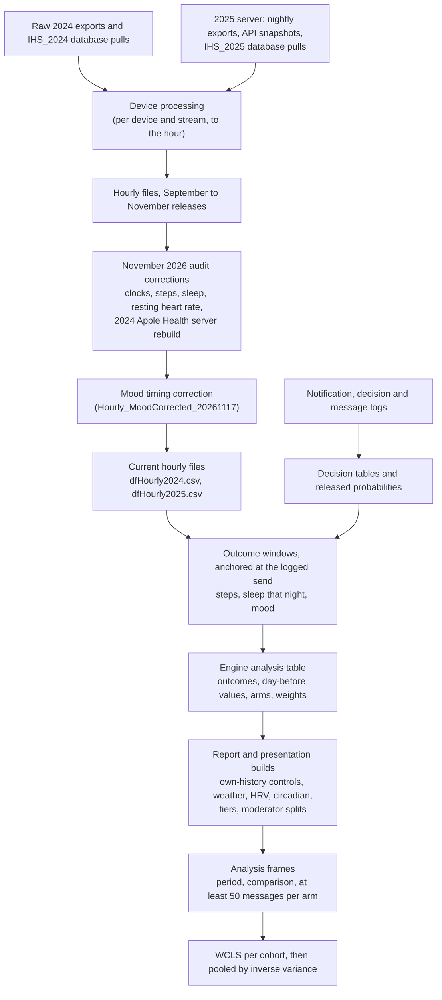

# 00. Preprocessing and model: overview

**Summary.** These notes describe every step between the raw study exports and the numbers in the presentation and
the report: the raw sources, the hourly files and their November 2026 corrections, the decision tables and
randomization probabilities, the outcome windows, controls and moderators, the rules that form each analysis frame,
and the estimator. They are written to be complete rather than short; the curated text one folder up picks what
matters and links here. Claude wrote them on 2026-11-25 from the code, the data READMEs and the audit record. Nobody
has reviewed them yet.

## Contents

- [How to read these notes](#how-to-read-these-notes)
- [From raw data to estimates](#from-raw-data-to-estimates)
- [The notes](#the-notes)
- [Files the current results use](#files-the-current-results-use)
- [Points most likely to matter](#points-most-likely-to-matter)
- [Open items across the notes](#open-items-across-the-notes)

## How to read these notes

- **Status.** Every rule says whether it is **Applied** (in the files and code the current results use), **Staged,
  not applied**, **Proposed**, **Withheld**, **Rejected**, **Superseded**, or (for code) **Option, not default**. Much
  of the November 2026 audit produced staged or proposed rules that never reached the current files, so the status
  matters as much as the rule.
- **Sources.** Each claim ends with `[src: ...]`. Code in this repository is cited by path: `causal/...` is the causal
  engine (for now under `Drew's code/causal`), `report/...` the report project. Files outside the repository use
  placeholders:

  | Placeholder | What it is |
  |---|---|
  | `<shared>` | The shared study-data folder: the published hourly, decision, probability and survey files and their `README.md` |
  | `<vault>` | The project notes kept outside the repository, including the 32-note `Data Preprocessing/` record, the audit message board and decision summary. `<vault>/Presentation Plots/` is short for the presentation pipeline's folder, `<vault>/Results and Document Compilation/Presentation Plots/` |
  | `<board>` | The audit message board, `<vault>/Audit Message Board.md`, cited by post date and time |
  | `<audit>` | The collaborative audit's working folders (Codex's and Claude's scripts, staged candidates and records) |
  | `<preprocessing-repo>` | The device-processing package that built the hourly files from the raw exports |
  | `<raw2023>`, `<raw2024>` | The 2023 and 2024 cohorts' raw export folders |
  | `<server2025>` | A local mirror of the 2025 study server's data (`nightly`, `api`, `participants`, `custom_fields`) and agent code; `<server>` in note 06 is its `agents/` code, copied June 19-21, 2026 |
  | `<prior-data>` | Earlier decision-level builds (`dfEvents2023/2024/2025.csv`) |
  | `<scratch>` | A temporary folder holding a few scripts behind the presentation; they must be moved into this repository |
  | `<memory>` | Claude's dated working notes from earlier sessions; background only, checked against records where possible |

- **Cohorts.** 2024 and 2025 are kept separate throughout; 2023 appears only as an earlier build for comparison.
- **No study results.** These notes give methods and preprocessing counts (rows, hours, decisions changed), never
  effect estimates.

## From raw data to estimates

## The notes

| Note | What it answers |
|---|---|
| [01 Raw sources](01-raw-sources.md) | What each cohort's raw exports and server sources hold, their time spans, how each stores timestamps, and which raw streams are unused |
| [02 Hourly files](02-hourly-files.md) | The 25 columns of the hourly files; how steps, heart rate, resting heart rate, sleep and mood are built per device; priority and deduplication; missing values; validation; the version history |
| [03 Clocks and time zones](03-clocks-and-time-zones.md) | How each stream reaches its UTC hour: the 2024 phone time-zone history; the 2025 roster zone, record offsets and staged clocks v1 to v3; what the current 2025 file applies |
| [04 Audit corrections](04-audit-corrections.md) | Each November 2026 correction: problem, rule, who decided and when, status, size, evidence; a register table and the open items |
| [05 Mood timing](05-mood-timing.md) | The 4 to 8 hour mood offset in 2025 and how both cohorts' mood was re-placed at each response's completion time |
| [06 Decisions and probabilities](06-decisions-and-probabilities.md) | The trial design as it bears on the data, the decision tables, delivery and reach, every probability scope, message coding and tiers, and how the engine reads them |
| [07 Outcome windows](07-outcome-windows.md) | How each decision gets its steps, sleep and mood outcome and its day-before values: anchor, window length, wear, zero-step days, sleep nights |
| [08 Controls](08-controls.md) | The engine's five controls, the report's standard set used by the figures, and the fuller sets of the precision chapter |
| [09 Moderators](09-moderators.md) | Every moderator in the report and the presentation: definition, timing against the decision, source, usual value, split, missing values |
| [10 Analysis rules](10-analysis-rules.md) | Periods, cohorts and pooling, the minimum of 50 messages per arm, which decisions enter each comparison, missing moderators, the aggregate-only guard |
| [11 Model](11-model.md) | The WCLS estimator, weights, centring, the estimand, influence-based standard errors, pooling, and the collinearity fix of engine 0.2.2 |

## Files the current results use

| Input | File | Detail |
|---|---|---|
| Hourly data, 2024 | `<shared>/Hourly_MoodCorrected_20261117/dfHourly2024.csv`, SHA-256 prefix `c16bd124c02d` | The Stage C rebuild of 2024 with mood re-placed. [02](02-hourly-files.md#which-files-current-results-use), [05](05-mood-timing.md) |
| Hourly data, 2025 | `<shared>/Hourly_MoodCorrected_20261117/dfHourly2025.csv`, SHA-256 prefix `2df0f3e1131d` | The November 17 rebuild of 2025 with mood re-placed. [02](02-hourly-files.md#which-files-current-results-use), [05](05-mood-timing.md) |
| Decisions and probabilities | The decision, probability and timing files in `<shared>` | Which file, which columns, and which rows the engine keeps: [06](06-decisions-and-probabilities.md#how-the-engine-reads-decisions-and-probabilities) |
| Further inputs | Weather, heart rate variability, circadian and earlier-build files | Named in `report/ihs_report/inputs.py`. [09](09-moderators.md) |

The hourly files are newer than the two `dfHourly` files at the top of `<shared>`. The engine's per-machine
configuration points to them, and every result records the fingerprints of the files that made it.

## Points most likely to matter

These are the facts a reader of the presentation or report is most likely to need, each with the note that holds the
detail.

1. **The hourly files the results use have not been independently reviewed.** The mood-corrected pair was put into
   use on 2026-11-17 ahead of its review. [05](05-mood-timing.md#review-status)
2. **The outcome window starts at the logged send,** not at the decision's date label, and runs to the next day's
   decision. 2025 mirrors 2024. [07](07-outcome-windows.md#anchor)
3. **Only delivered sends, and no-send days a message could have reached,** enter the main analysis. In 2025 about
   23% of decisions marked sent were not delivered. [06](06-decisions-and-probabilities.md)
4. **2025 probabilities are the released, posterior-averaged ones,** not the single Thompson draw logged at the
   decision. The September 4-27, 2025 fitted probabilities are withheld. [06](06-decisions-and-probabilities.md#randomization-probabilities-2025)
5. **2024 sent with probability 0.5,** and its decision table was rebuilt from the full-year notification log,
   including a server bug that removed some sleep messages from the pool.
   [06](06-decisions-and-probabilities.md#decision-tables-2024)
6. **The 2025 clock fix is partial.** Apple Health is placed by each record's own UTC time and Fitbit by an approved
   day-level clock (held Fitbit days keep the original placement), but rows before March 1, 2025 keep the original
   clock.
   [03](03-clocks-and-time-zones.md#status-summary)
7. **Some approved corrections are not in the files,** most importantly the iPhone-first phone-step rule for 2025 and
   75 days of the Garmin Connect resting-heart-rate date fix. [04](04-audit-corrections.md#items-still-open)
8. **Steps are log(1 + steps)** on days with at least 10 observed hours and a step record (in the report and the
   presentation, also at least one step); sleep is minutes asleep in the window that holds the night after the message; mood is the mean of responses in the window. [07](07-outcome-windows.md)
9. **The figures adjust for the standard control set:** the engine's five plus the participant's own past mean of the
   outcome and two missing-value flags. [08](08-controls.md#the-standard-set)
10. **Not every moderator is measured before the decision.** The weather measures cover the decision date and the next
    day, and a few person-level descriptors use the whole study year. [09](09-moderators.md#measured-at-or-after-the-decision)
11. **A comparison needs at least 50 messages per arm** in the frame, and drops decisions where a compared arm's
    probability is below 0.001 (2024) or 0.01 (2025). [10](10-analysis-rules.md#settings-by-pipeline)
12. **Engine versions up to 0.2.1 inverted singular matrices silently;** 0.2.2 fixed it, and current results use
    0.2.2. [11](11-model.md)

## Open items across the notes

Each note ends with its own open and unverified items. The full list, with what each affects and a next step, is in
[3. Problems](../../3.%20Problems/01-from-the-preprocessing-notes.md). The ones that cut across notes:

- The independent review of the mood-corrected hourly files and of the 2024 Stage C rebuild is still owed.
  [05](05-mood-timing.md#review-status), [04](04-audit-corrections.md#items-still-open)
- Several approved rules await a rebuild. The 2025 iPhone-first phone-step rule is the main one: the server pass
  returned its parts, but no 2025 file was built from them. [04](04-audit-corrections.md#items-still-open)
- The presentation's pipeline, three audit caches it reads, and four scratch scripts are outside this repository, so
  the presentation cannot yet be rebuilt from the data alone. [09](09-moderators.md#built-outside-the-repository)
- The circadian files are used as supplied; how they were made is not documented here.
  [09](09-moderators.md#circadian-misalignment)
- The engine builds its own 2025 windows over 296,194 retained decisions, while the published window flag marks
  294,777; whether the two agree has not been checked. [06](06-decisions-and-probabilities.md), [07](07-outcome-windows.md#unverified)
- The presentation's tables do not pass the report's aggregate-only guard (`guard.py`); only three identifying column
  names are checked, and small counts are not. Its "pooled" rows fall back to the one cohort when a family exists in
  2024 only. [10](10-analysis-rules.md)
- Some design documents lag the code: the engine's design notes still treat a blank step cell as zero, and the report
  README still gives 200 messages per arm. [07](07-outcome-windows.md#where-code-and-documentation-disagree),
  [10](10-analysis-rules.md)
